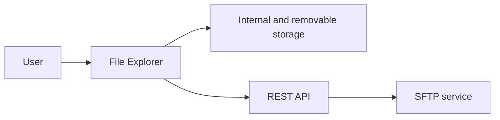
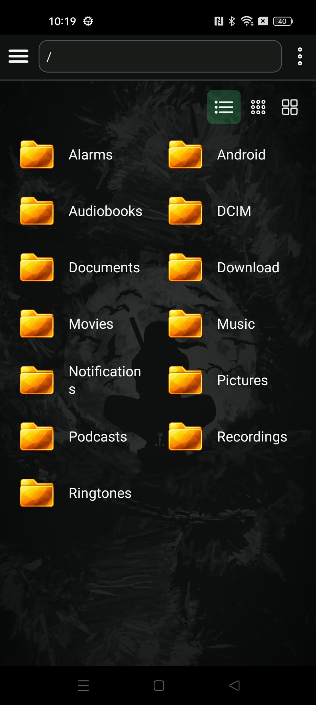
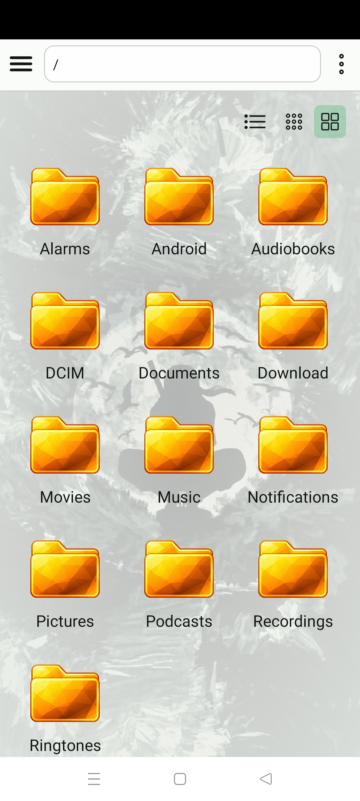
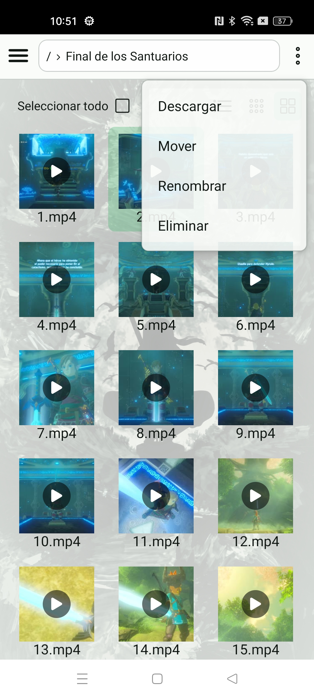
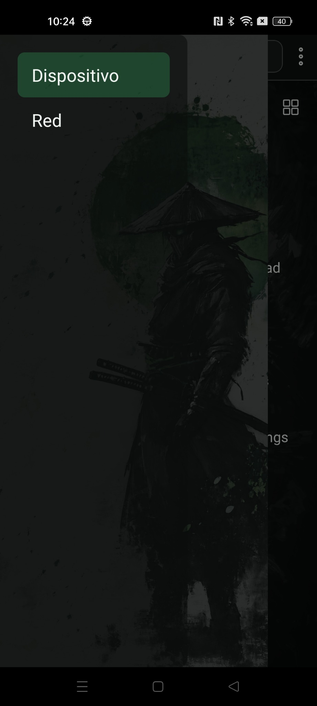
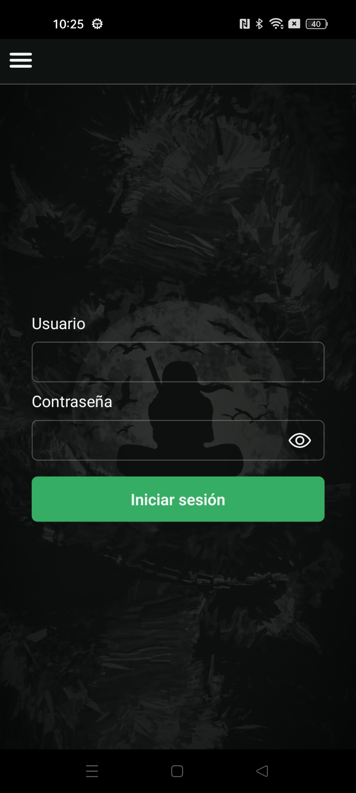
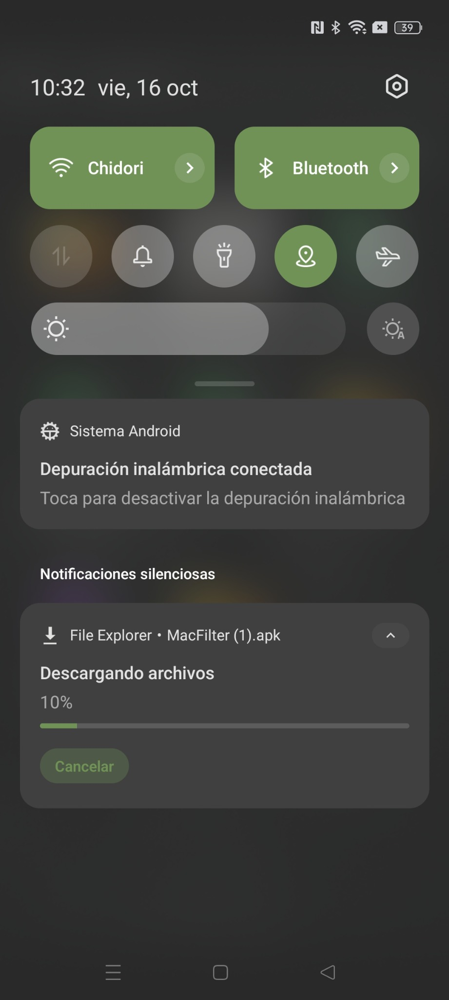
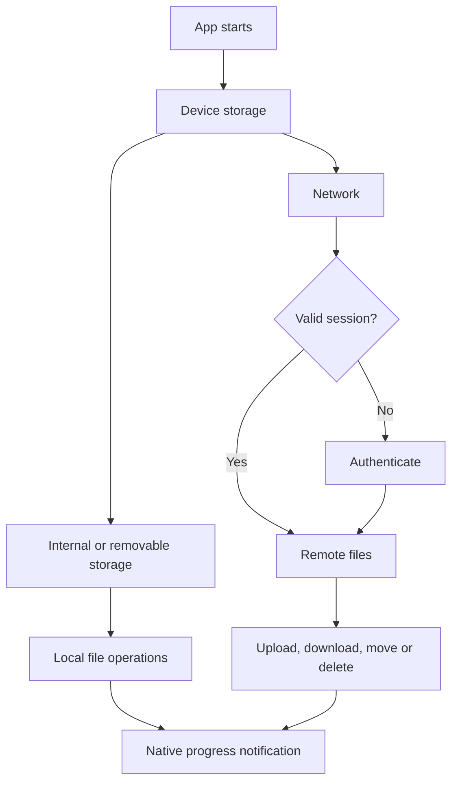
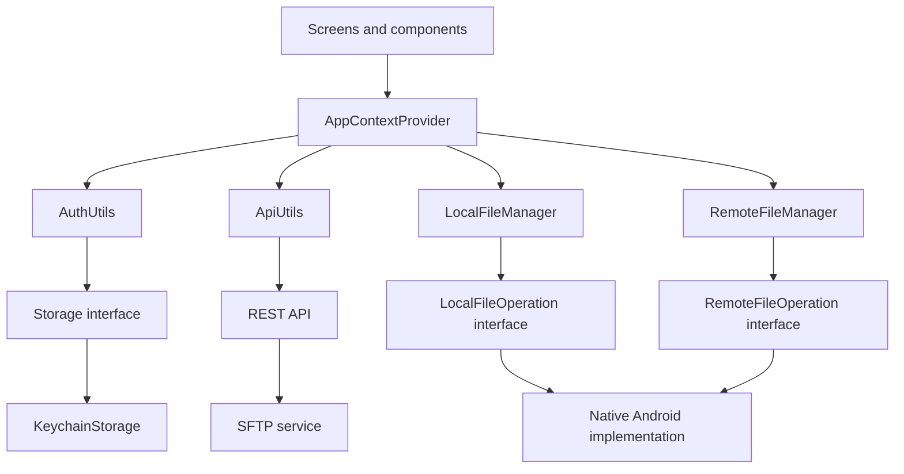

# File Explorer

[](https://reactnative.dev/)
[](https://www.typescriptlang.org/)
[](https://pnpm.io/)
[](LICENSE)

File Explorer is an Android file manager built with React Native. It combines local and removable storage with an authenticated remote workspace backed by an API and SFTP.



## Why this project?

File Explorer began as an alternative to Android file managers overloaded with advertising and unable to cover both local storage and network access in one place.

The first goal was to work with local connections and Samba. The project then evolved into a local FTP-oriented file explorer and, finally, into the current remote model: the Android client communicates with an API that operates against an SFTP service. With a small API and an SFTP container running on Ubuntu - whether in a virtual machine or on a dedicated server - the same application can provide remote access to the server's files from outside the home network.

The Android application is the client of that system. Deployment, exposure to the internet and server hardening are separate responsibilities and are not automated by this repository.

## Features

| Area                  | Capabilities                                                                                                                                    |
| --------------------- | ----------------------------------------------------------------------------------------------------------------------------------------------- |
| Local storage         | Browse internal and removable storage; create folders; rename, copy, move and delete entries; open compatible files; extract supported archives |
| Network workspace     | Authenticate and browse remote directories through the API; create folders; rename, move and delete entries; upload and download files          |
| Background operations | Native Android operations report progress and completion through notifications and in-app messages                                              |
| File views            | List, compact-icon and large-icon modes, with the selected mode persisted between launches                                                      |
| Thumbnails            | Background generation and bounded caching of local image and video thumbnails, plus remote thumbnail availability checks                        |
| Synchronization       | Directory versions avoid replacing visible content when nothing has changed                                                                     |
| Authentication        | JWT login, session restoration, refresh flow and secure token storage through the Android keychain                                              |
| Interface             | System light/dark theme, selection mode, path navigation, contextual actions and Android back-button handling                                   |

## Screenshots

<table>
  <tr>
    <td align="center"><strong>Local files</strong></td>
    <td align="center"><strong>Light theme</strong></td>
    <td align="center"><strong>Remote file actions</strong></td>
  </tr>
  <tr>
    <td></td>
    <td></td>
    <td></td>
  </tr>
  <tr>
    <td align="center"><strong>Device and Network</strong></td>
    <td align="center"><strong>Remote login</strong></td>
    <td align="center"><strong>Background download</strong></td>
  </tr>
  <tr>
    <td></td>
    <td></td>
    <td></td>
  </tr>
</table>

The user-facing navigation calls the remote area **Network** (`Red` in the Spanish interface). Internal names such as `ftp`, `FtpEntry` and `FTP_VERSION` remain in parts of the codebase for historical and compatibility reasons.

## Application flow



## Architecture

Screens work through the application context instead of constructing platform services themselves. `AppContextProvider` creates the concrete dependencies once and injects their contracts into the managers.



| Layer                          | Responsibility                                                                                              |
| ------------------------------ | ----------------------------------------------------------------------------------------------------------- |
| Screens and components         | Render directories, collect input and trigger typed requests                                                |
| App context                    | Compose dependencies, expose shared state and coordinate API/local request execution                        |
| `AuthUtils`                    | Log in, restore or clear a session, refresh tokens and manage the Axios authorization interceptor           |
| `ApiUtils`                     | Encapsulate the HTTP contract and normalize successful and failed responses                                 |
| `LocalFileManager`             | Coordinate local listing, file operations, directory versions and restoration                               |
| `RemoteFileManager`            | Coordinate uploads, downloads and remote file operations, progress and completion                           |
| Interfaces and implementations | Isolate the filesystem, secure storage, permissions, thumbnails and native operations from React components |

### Native file access

`LocalFileManager` and `RemoteFileManager` receive native operation contracts through their constructors. Android performs directory listing, local operations and upload preparation with its own filesystem APIs; TypeScript receives typed directory entries and operation results.

`NativeLocalFileOperation` exposes internal and removable storage roots to `AppContextProvider`. The concrete adapters for roots, operations, storage and permissions are created outside the managers, which keeps platform details replaceable and prevents managers from constructing their own dependencies.

### Session and token handling

After login or refresh, `AuthUtils` installs the access token in an Axios request interceptor. The interceptor holds the active token in memory and adds the `Authorization` header to API requests. The previous interceptor is replaced when the session changes and removed on logout.

The access token and refresh token are also stored through the generic `Storage` interface backed by `KeychainStorage`. This secure persistence lets native operations and other application components obtain the current token without depending on Axios, and supports session restoration after restarting the app. Tokens are removed when the session is cleared. Non-secret interface preferences, such as the selected view mode, use the native SQLite-backed database.

## Technical stack

- React Native 0.87.1 and React 19
- TypeScript
- React Navigation
- Axios
- React Native Keychain
- React Native Gesture Handler and Reanimated
- pnpm
- Native Android modules for file operations, storage discovery, SQLite persistence and thumbnails

## Installation

### Prerequisites

- Node.js 22.13+, 24.3+ or 26+
- pnpm 12.11.2
- JDK 17
- Android SDK Platform 37.0 and Build Tools 37.0.0
- Android NDK 27.1.12297006
- Android emulator or physical device
- Compatible backend API reachable from the device

### Setup

```bash
git clone https://github.com/HattoriHanzo-Ronin/file-explorer.git
cd file-explorer
pnpm install --frozen-lockfile
cp .env.example .env
```

Set the backend URL in `.env`:

```env
API_URL=http://<api-host>:<port>
```

The API address must be reachable from the Android device or emulator. Do not commit real addresses, credentials or tokens.

Start Metro and run the Android application:

```bash
pnpm start
pnpm android
```

## Quality checks

```bash
pnpm lint
pnpm format:check
pnpm exec tsc --noEmit
pnpm test --runInBand
```

The Jest suite runs the application shell with native navigation adapters mocked and covers the core application logic:

- `ApiUtils`: API contract normalization, directory versions and thumbnails.
- `AuthUtils`: login, token persistence, session restoration and cleanup.
- `LoadingUtils` and `FileUtils`: concurrent loading state, validation, hashing and file classification.
- `LocalFileManager` and `RemoteFileManager`: local and remote operations, collisions, background-operation state and completion handling.
- `UiUtils` and the overflow menu: operation messages, dialog submission and validation feedback.

Run the complete suite with `pnpm test --runInBand`. The tests are located outside `src` under `tests`, mirroring the source structure; the app-shell mounting test remains under `__tests__`.

## Project structure

```text
file-explorer/
|-- android/                  # Native Android project and modules
|-- ios/                      # React Native iOS project (not verified)
|-- src/
|   |-- app/
|   |   |-- ftp/              # Internal route name; displayed as Network
|   |   `-- local/
|   |-- components/
|   |-- constants/
|   |-- hooks/
|   |-- styles/
|   |-- types/
|   `-- utils/
|       |-- files/
|       |   `-- impl/
|       |-- operations/
|       |-- permissions/
|       |   `-- impl/
|       |-- storage/
|       |   `-- impl/
|       `-- thumbnails/
|           `-- impl/
|-- tests/                    # Utility and file-manager tests
|-- __tests__/                # App-shell mounting test
|-- screenshots/              # README screenshots
|-- package.json
`-- README.md
```

## Key decisions

- **User-facing Network section:** the interface uses the broader label `Red` instead of exposing the historical FTP implementation name.
- **API-mediated SFTP access:** the Android client talks to the REST API; it does not connect directly to the SFTP server.
- **Dependency injection:** file managers receive filesystem, native-operation, storage and permission contracts from `AppContextProvider`.
- **Secure cross-component session state:** Axios keeps the active authorization interceptor in memory, while Keychain-backed storage makes tokens available to native operations and session restoration.
- **Native background work:** Android owns long-running file operations and reports their progress through persistent notifications.
- **All-or-nothing transfers:** interrupted or failed transfers restart from zero rather than resuming partial data.
- **Local operation recovery:** coordinated paths, staged writes and persisted operation records support cleanup and recovery after failures or interruptions, including downloads written to local storage.
- **Version-based refresh:** lightweight directory versions avoid unnecessary content reloads.
- **Separate preference storage:** the selected directory view mode belongs in native SQLite storage; authentication secrets do not. The application theme follows the system setting.

## Scope and verification notes

- The screenshots verify the Android interface, the `Red` label, view modes, contextual file actions and a background download notification.
- The source verifies constructor injection, the filesystem and remote-operation contracts, Axios interceptor handling, Keychain-backed storage and the current toolchain versions.
- The supplied technical PDF documents the API/SFTP boundary and previous device checks, but it explicitly does not verify the server deployment, iOS builds, release signing or publication.
- Samba describes the project's origin, not a feature claimed for the current client.

## License

This project is licensed under the [MIT License](LICENSE).
